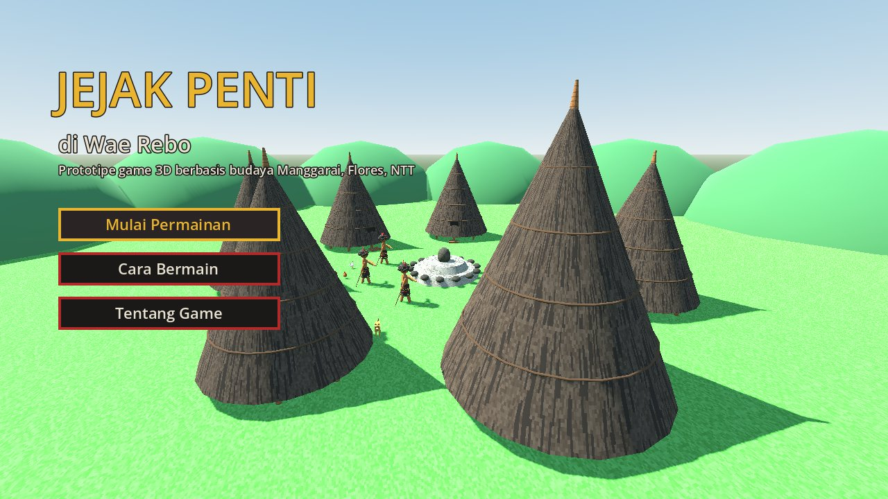
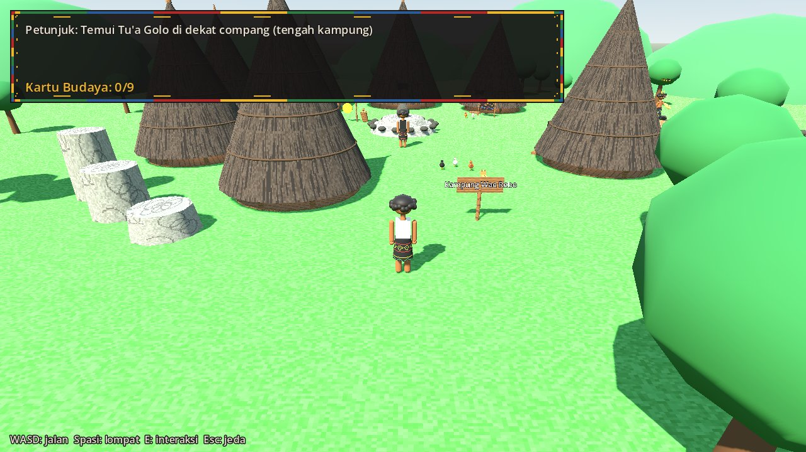
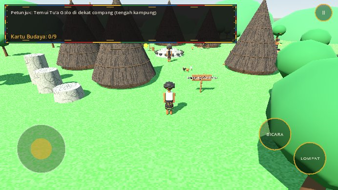

# Laporan Proses Pengembangan
## Prototipe Game 3D Berbasis Budaya Lokal: *Jejak Penti di Wae Rebo*

**Nama:** Romanus Sudimin · **NIM:** 240030260 · **Program studi:** Sistem Informasi · **Mata kuliah:** Pengembangan Permainan Digital

---

## 1. Pendahuluan
Tugas ini bertujuan menerapkan teknik pengembangan game digital sambil mengintegrasikan unsur budaya lokal. Budaya yang diangkat adalah budaya **Manggarai** (Flores, NTT) dalam bentuk game 3D **jelajah budaya**. Pemain menemui warga kampung bergaya Wae Rebo secara berurutan lewat rantai teka-teki, menenun songke, dan menabuh gong-gendang untuk mengumpulkan 9 kartu pengetahuan, lalu menyaksikan caci pada perayaan Penti. Prototipe dapat dimainkan dari menu sampai ending dalam ±10–15 menit.

## 2. Ringkasan Penelitian Budaya
Studi literatur (lihat `docs/riset/laporan-penelitian-budaya.md`) menghasilkan fakta kunci berikut:
- **Caci** dimainkan oleh paki dengan *larik* (cambuk kulit kerbau) melawan ta'ang dengan *nggiling* (perisai) dan *agang/tereng*. Perannya bergantian dan sasaran sah hanya tubuh di atas pinggang. Nilai utamanya sportivitas dan persaudaraan.
- **Wae Rebo** memiliki 7 Mbaru Niang (1 mbaru gendang + 6 mbaru gena) dengan 5 tingkat dan meraih penghargaan UNESCO Asia-Pacific 2012.
- **Compang** adalah altar batu di natas; **Penti** adalah tahun baru adat dan syukur; **songke** adalah kain tenun berdasar hitam dengan motif bermakna.
Fakta tersebut diterjemahkan ke mekanik, visual, audio, narasi, dan 9 kartu pengetahuan.

## 3. Konsep & Desain
Konsep dan desain lengkap ada di `docs/gdd/GDD.md`. Core loop: temui warga yang ditunjuk petunjuk → tantangan (teka-teki / tenun / tabuh) → kartu budaya → petunjuk ke warga berikutnya → Penti.

**Perubahan konsep.** (1) Konsep awal: game 2D dengan teka-teki lingko + duel caci. (2) Diubah menjadi 3D dengan duel caci sebagai inti (ta'ang & paki, 3 lawan). (3) Setelah dicoba, duel caci dinilai terlalu sulit bagi pemain umum, sehingga konsep akhir menjadi **jelajah budaya**: rantai teka-teki berurutan, mini-game menenun songke dan tabuh gong-gendang, dan caci ditampilkan sebagai pertunjukan Penti. Kode duel dihapus, sedangkan FSM karakter caci dipakai ulang untuk pertunjukan.

## 4. Proses Implementasi
| Tahap | Hasil |
|---|---|
| Setup | Project Godot 4, renderer Compatibility (ringan, mendukung web), resolusi dasar 640×360 diskalakan ke 1280×720 |
| Aset | Pipeline prosedural: tekstur dengan Pillow, audio dengan numpy (sintesis gong/gendang) |
| Fondasi | Input Map lewat kode; GameState FSM; StateMachine generik berbasis node |
| Kontrol pemain | CharacterBody3D, akselerasi/gesekan, coyote time, jump buffer, lompat variabel, collision dengan tanah/rumah/batu/pohon/dinding |
| Karakter | KarakterModel dari mesh primitif dengan sendi pivot dan animasi prosedural (Tween + sinus) |
| Dunia | Builder `Dunia`: Mbaru Niang, compang, gong-gendang, arena, pohon, bukit, langit |
| Interaksi | Area3D `Interaktif` (memilih objek terdekat), NPC, kartu budaya di dalam Mbaru Niang, dialog berbasis JSON |
| Rantai teka-teki | 9 langkah berbasis data JSON: pemegang kartu, jenis tantangan, pertanyaan/pilihan/jawaban, petunjuk ke warga berikutnya; teka-teki pilihan ganda bersuara |
| Mini-game | Menenun Songke (teka-teki pola 5×5, keyboard & mouse) dan Tabuh Gong-Gendang (ritme 2 jalur, jendela ±0,2 dtk) |
| Pertunjukan caci | Dua penampil dengan FSM 5 state bergantian menjadi paki & ta'ang di ending |
| UI | Menu utama 3D, HUD, menu jeda, transisi fade, ending Penti |
| Suara dialog | Text-to-Speech bahasa Indonesia (`DisplayServer.tts_speak`) dengan nada berbeda per tokoh; teks sebagai cadangan |
| Warga | Model perempuan + nampan kopi; jeda kopi antarronde yang memulihkan stamina |

Detail kronologis ada di `docs/laporan/log-pengembangan.md`.

{width=75%}

{width=75%}

{width=75%}

_[Tambahkan screenshot: teka-teki Tu'a Golo, menenun songke, tabuh gong-gendang, ending Penti]_

## 5. Arsitektur Teknis
- **State management tiga lapis:** (1) `GameState` dengan transisi tervalidasi dan progres `langkah_rantai`; (2) FSM pemain (Idle, Jalan, Lompat, Jatuh, Interaksi); (3) FSM penampil caci (Siaga, Ancang, Serang, Tangkis, Terkena) pada pertunjukan Penti.
- **Pemisahan data dan kode:** dialog dan kartu disimpan di `data/*.json`; parameter kesulitan dikumpulkan di `KONFIG_LAWAN`.
- **Komunikasi lewat sinyal** sehingga antarskrip tidak saling bergantung langsung.
- **Kode yang dapat dipakai ulang:** `StateMachine`, `KarakterModel`, `Dunia`, dan `Gaya` dipakai di banyak scene.

## 6. Pengujian & Iterasi
- **Validasi statis:** seluruh skrip lolos parser GDScript (gdtoolkit 4.3). Path resource, nama state, id dialog, dan id kartu diperiksa otomatis dengan skrip.
- **Uji fungsional:** mengikuti `docs/playtest/rencana-uji.md`. Game berhasil dijalankan dari menu sampai bermain di Godot 4.7.2 (macOS). Versi web dibangun otomatis oleh GitHub Actions dan diuji di Chromium mode HP: menu tampil, permainan dapat dimulai dengan ketukan, kontrol sentuh muncul, dan tidak ada error di konsol.
- **Iterasi dari uji coba pengembang:** kabut dihapus agar kampung terlihat; kartu dipindah dari atas batu ke tangan warga; petunjuk diubah menjadi teka-teki ciri orang/rumah; 3 pemegang kartu ditempatkan di dalam Mbaru Niang dan 3 lainnya berpindah tempat; ditambah kontrol sentuh untuk HP.
- **Playtest:** _[isi ringkasan dari `docs/playtest/hasil-playtest.md`: jumlah penguji, temuan utama, iterasi yang dilakukan]_

## 7. Hasil Akhir & Keterbatasan
**Hasil:** game 3D jelajah budaya yang dapat dimainkan dari awal sampai akhir, dengan rantai teka-teki 9 langkah, 2 mini-game (tenun & tabuh), dialog bersuara, 9 kartu budaya, pertunjukan caci, musik dan SFX gong-gendang, serta animasi yang menerapkan prinsip animasi dasar.

**Keterbatasan:**
- Model low-poly sederhana tanpa rig.
- Kamera tidak bisa diputar.
- Belum ada fitur simpan permainan.
- Musik sintetis, bukan rekaman asli.
- Sebagian sumber riset baru diverifikasi dari abstrak.

## 8. Kesimpulan & Pengembangan Lanjutan
Budaya Manggarai dapat dijalin menjadi permainan jelajah yang mendidik: pengetahuan dari satu warga menjadi kunci untuk menemui warga berikutnya, sementara songke dan gong-gendang menjadi mekanik pola dan ritme yang mudah dimainkan. Pengembangan lanjutan:
- Mekanik teka-teki **lingko lodok**.
- Rekaman gong-gendang asli dengan izin komunitas.
- Model 3D yang lebih detail.
- Kamera bebas dan dukungan gamepad.
- Konsultasi dengan budayawan Manggarai.

## Lampiran
- Asset references: `docs/gdd/asset-references.md`
- Daftar pustaka: `docs/riset/catatan-riset.md`
