::: {custom-style="Cover Judul"}
LAPORAN PROYEK
:::

::: {custom-style="Cover Judul"}
PERANCANGAN DAN IMPLEMENTASI GAME 3D BERBASIS BUDAYA LOKAL MANGGARAI "JEJAK PENTI DI WAE REBO"
:::

::: {custom-style="Cover"}
Disusun untuk memenuhi Rencana Tugas 1: Prototipe Game Berbasis Budaya Lokal

Mata Kuliah: Pengembangan Permainan Digital
:::

::: {custom-style="Cover Logo"}
{width=5.5cm}
:::

::: {custom-style="Cover"}
Disusun oleh:
:::

::: {custom-style="Cover Tebal"}
ROMANUS SUDIMIN

NIM 240030260
:::

::: {custom-style="Cover"}
Dosen Pengampu:
:::

::: {custom-style="Cover Tebal"}
I GEDE SUARDIKA, S.Kom., M.Kom.
:::

::: {custom-style="Cover Bawah"}
PROGRAM STUDI SISTEM INFORMASI

INSTITUT TEKNOLOGI DAN BISNIS STIKOM BALI

2026
:::

```{=openxml}
<w:p><w:pPr><w:sectPr><w:pgSz w:w="11906" w:h="16838"/><w:pgMar w:top="1701" w:right="1701" w:bottom="1701" w:left="2268" w:header="709" w:footer="709" w:gutter="0"/></w:sectPr></w:pPr></w:p>
```

# KATA PENGANTAR

Puji syukur penulis panjatkan ke hadirat Tuhan Yang Maha Esa karena atas berkat dan rahmat-Nya penulis dapat menyelesaikan laporan proyek berjudul "Perancangan dan Implementasi Game 3D Berbasis Budaya Lokal Manggarai *Jejak Penti di Wae Rebo*". Laporan ini disusun untuk memenuhi Rencana Tugas 1, Prototipe Game Berbasis Budaya Lokal, pada mata kuliah Pengembangan Permainan Digital, Program Studi Sistem Informasi, Institut Teknologi dan Bisnis STIKOM Bali.

Laporan ini menyatukan seluruh hasil proyek sesuai tahapan tugas, mulai dari penelitian budaya sampai dokumentasi. Melalui proyek ini penulis berupaya memperkenalkan budaya Manggarai, Flores, Nusa Tenggara Timur, lewat permainan digital yang dapat dimainkan di laptop maupun telepon genggam.

Pada kesempatan ini penulis mengucapkan terima kasih kepada:

1. Bapak I Gede Suardika, S.Kom., M.Kom., selaku dosen pengampu mata kuliah Pengembangan Permainan Digital yang telah memberikan arahan dan bimbingan.
2. Teman-teman yang bersedia menjadi penguji (*playtester*) dan memberikan masukan berharga untuk perbaikan game.
3. Keluarga yang selalu memberikan doa dan semangat.
4. Semua pihak yang telah membantu dan tidak dapat penulis sebutkan satu per satu.

Penulis menyadari laporan ini masih jauh dari sempurna, sehingga kritik dan saran yang membangun sangat penulis harapkan. Semoga laporan ini bermanfaat dan menjadi langkah kecil dalam melestarikan budaya Manggarai.

::: {custom-style="Tanda Tangan"}
Denpasar, 13 November 2026

Penulis,

```{=openxml}
<w:p><w:pPr><w:pStyle w:val="TandaTangan"/></w:pPr></w:p>
```

Romanus Sudimin
:::

::: {custom-style="Judul Awal"}
DAFTAR ISI
:::

```{=openxml}
<w:p><w:r><w:fldChar w:fldCharType="begin"/></w:r><w:r><w:instrText xml:space="preserve"> TOC \o "1-3" \h \z \u </w:instrText></w:r><w:r><w:fldChar w:fldCharType="separate"/></w:r><w:r><w:t>Klik kanan lalu pilih Update Field untuk memperbarui daftar isi.</w:t></w:r><w:r><w:fldChar w:fldCharType="end"/></w:r></w:p>
```

::: {custom-style="Judul Awal"}
DAFTAR GAMBAR
:::

```{=openxml}
<w:p><w:r><w:fldChar w:fldCharType="begin"/></w:r><w:r><w:instrText xml:space="preserve"> TOC \h \z \t "Image Caption,1" </w:instrText></w:r><w:r><w:fldChar w:fldCharType="separate"/></w:r><w:r><w:t>Klik kanan lalu pilih Update Field untuk memperbarui daftar gambar.</w:t></w:r><w:r><w:fldChar w:fldCharType="end"/></w:r></w:p>
```

::: {custom-style="Judul Awal"}
DAFTAR TABEL
:::

```{=openxml}
<w:p><w:r><w:fldChar w:fldCharType="begin"/></w:r><w:r><w:instrText xml:space="preserve"> TOC \h \z \t "Table Caption,1" </w:instrText></w:r><w:r><w:fldChar w:fldCharType="separate"/></w:r><w:r><w:t>Klik kanan lalu pilih Update Field untuk memperbarui daftar tabel.</w:t></w:r><w:r><w:fldChar w:fldCharType="end"/></w:r></w:p>
```

```{=openxml}
<w:p><w:pPr><w:sectPr><w:pgSz w:w="11906" w:h="16838"/><w:pgMar w:top="1701" w:right="1701" w:bottom="1701" w:left="2268" w:header="709" w:footer="709" w:gutter="0"/><w:pgNumType w:fmt="lowerRoman" w:start="1"/></w:sectPr></w:pPr></w:p>
```

# BAB I PENDAHULUAN

## 1.1 Latar Belakang

Indonesia memiliki ribuan unsur budaya lokal berupa rumah adat, upacara, kain tradisional, musik, dan permainan rakyat. Namun, minat generasi muda terhadap budaya daerah cenderung menurun. Kajian tentang tari caci di Manggarai, misalnya, mencatat bahwa minat generasi muda terhadap caci menurun sehingga diperlukan upaya pelestarian (*Pilar*, 2025). Di sisi lain, generasi muda sangat akrab dengan permainan digital. Game dapat menjadi media yang menarik untuk memperkenalkan budaya karena pemain tidak hanya membaca, tetapi juga mengalami dan berinteraksi langsung dengan unsur budaya tersebut.

Budaya Manggarai di Pulau Flores, Nusa Tenggara Timur, memiliki unsur yang sangat kaya. Kampung adat Wae Rebo dengan tujuh rumah kerucut Mbaru Niang meraih penghargaan UNESCO Asia-Pacific Awards for Cultural Heritage Conservation tahun 2012. Masyarakat Manggarai juga mengenal compang (altar batu di tengah kampung), Penti (perayaan tahun baru adat), kain tenun songke, musik gong-gendang, dan caci, yaitu tari-tarung cambuk yang menjunjung sportivitas. Kekayaan ini sangat potensial untuk diangkat menjadi game edukatif.

Berdasarkan hal tersebut, penulis mengembangkan *Jejak Penti di Wae Rebo*, sebuah prototipe game 3D jelajah budaya. Pemain berperan sebagai Nggohak, pemuda Manggarai yang pulang ke kampung adat menjelang Penti. Pemain harus menemui delapan warga secara berurutan, memecahkan teka-teki, menenun songke, dan menabuh gong-gendang untuk mengumpulkan sembilan kartu pengetahuan budaya. Game dikembangkan dengan Godot Engine 4 dan dapat dimainkan langsung di browser laptop maupun telepon genggam.

## 1.2 Tujuan Tugas

Sesuai dokumen Rencana Tugas 1, tugas ini bertujuan melatih mahasiswa menerapkan teknik pengembangan game digital sambil mengintegrasikan unsur budaya lokal. Melalui tugas ini, mahasiswa diharapkan mampu:

1. Mengimplementasikan konsep pemrograman dasar (input, gerakan, *collision*) menggunakan *game engine*.
2. Menerapkan *state management* dan mekanik game sesuai GDD.
3. Mengintegrasikan aset visual dan audio yang sesuai dengan prinsip animasi dasar.
4. Meneliti dan mengadaptasi unsur budaya lokal (cerita, seni, atau musik) ke dalam desain game.
5. Mengembangkan prototipe game yang fungsional dengan muatan budaya yang kuat.

## 1.3 Objek dan Lingkup Tugas

Objek tugas adalah pengembangan prototipe game 2D/3D sederhana yang mengangkat unsur budaya lokal Indonesia, dengan mekanik *gameplay* dasar yang terimplementasi dengan baik. Judul tugas adalah "Pengembangan Prototipe Game Berbasis Budaya Lokal", dengan tujuan menghasilkan prototipe game yang memadukan teknik pengembangan game modern dengan kekayaan budaya lokal Indonesia. Dalam proyek ini penulis memilih game **3D** dengan budaya **Manggarai**.

Batasan proyek ini adalah sebagai berikut:

1. Game berupa prototipe dengan durasi bermain ±10–15 menit, dari menu utama sampai ending.
2. Visual memakai model *low-poly* yang dibangun dari bentuk dasar (*primitive mesh*) dan tekstur buatan sendiri.
3. Kampung dalam game *terinspirasi* Wae Rebo dan bukan replika persisnya. Seluruh tokoh bersifat fiktif.
4. Caci tidak dimainkan sebagai pertarungan, tetapi ditampilkan sebagai pertunjukan pada perayaan Penti.
5. Musik dan efek suara disintesis sendiri, bukan rekaman musik adat asli.

## 1.4 Metode dan Mekanisme

Mekanisme pengerjaan mengikuti ketentuan tugas, yaitu:

1. Tugas dikerjakan secara individu.
2. *Game engine* yang digunakan adalah **Godot Engine 4** (diuji pada versi 4.7.2) dengan bahasa GDScript.
3. Durasi pengerjaan empat minggu dengan konsultasi berkala kepada dosen.
4. Hasil dipresentasikan pada akhir periode.

Pengembangan dilakukan dalam lima tahapan beserta bobotnya sebagaimana ditunjukkan pada Tabel 1.1. Setiap tahapan dibahas dalam satu bab tersendiri pada laporan ini.

: Tabel 1.1 Tahapan Pelaksanaan dan Bab Pembahasan

| No | Tahapan | Bobot | Kegiatan utama | Bab |
|:--:|-----------------------|:----:|------------------------------------------------------------|:------:|
| 1 | Penelitian Budaya | 10% | Memilih unsur budaya, studi literatur, identifikasi elemen yang dapat diadaptasi | BAB II |
| 2 | Adaptasi Konsep | 20% | Menyusun GDD, core loop dan mekanik, integrasi budaya ke visual, audio, dan narasi | BAB III |
| 3 | Implementasi Teknis | 50% | Setup engine, kontrol dasar, state management, 2+ mekanik, aset visual dan audio, prinsip animasi | BAB IV |
| 4 | Testing dan Polish | 10% | Playtesting dengan user, iterasi berdasarkan feedback, penyempurnaan | BAB V |
| 5 | Dokumentasi | 10% | Laporan proses development, video demo, presentasi | BAB VI |

## 1.5 Timeline Pelaksanaan

Jadwal pengerjaan mengikuti timeline empat minggu dari dokumen tugas seperti pada Tabel 1.2.

: Tabel 1.2 Timeline Pelaksanaan

| Minggu | Kegiatan dari dokumen tugas | Hasil pada proyek ini |
|:------:|---------------------------------|----------------------------------------------------------|
| 1 | Research budaya dan penyusunan GDD | Catatan riset, glosarium ±70 istilah, tabel adaptasi, laporan penelitian budaya, GDD |
| 2 | Implementasi teknis dasar | Input, gerak dan lompat 3D, *collision*, GameState, FSM pemain |
| 3 | Implementasi mekanik dan integrasi aset | Rantai teka-teki, menenun songke, tabuh gong-gendang, tekstur, audio, animasi |
| 4 | Testing, polishing, dan dokumentasi | Playtest 3 penguji, iterasi, versi web/HP, laporan, slide, video demo |

## 1.6 Keluaran Tugas

Keluaran yang diharapkan dan wujudnya dalam proyek ini dirangkum pada Tabel 1.3.

: Tabel 1.3 Keluaran Tugas

| No | Keluaran | Wujud dalam proyek |
|:--:|------------------------------|------------------------------------------------------------|
| a | File executable (.exe/.apk/web build) | Web build yang dapat dimainkan di browser laptop dan HP: romanussudimin-debu.github.io/Pengembangan-Permainan-Digital. Preset ekspor Windows, macOS, dan Android juga tersedia. |
| b | Source code project | Repositori GitHub: github.com/romanussudimin-debu/Pengembangan-Permainan-Digital (folder `src/`) |
| c | Dokumentasi desain (GDD + asset references) | BAB III dan Lampiran B laporan ini |
| d | Laporan penelitian budaya | BAB II laporan ini |
| e | Video demo gameplay (1–2 menit) | Direkam berdasarkan naskah pada subbab 6.2 |

## 1.7 Sistematika Penulisan

Laporan ini disusun dengan sistematika sebagai berikut:

1. **BAB I Pendahuluan** berisi latar belakang, tujuan, objek dan lingkup, metode, timeline, keluaran, dan sistematika penulisan.
2. **BAB II Penelitian Budaya** berisi pemilihan unsur budaya, studi literatur tentang budaya Manggarai, identifikasi elemen yang dapat diadaptasi, dan pertimbangan etis.
3. **BAB III Adaptasi Konsep** berisi Game Design Document (GDD), core loop dan mekanik, serta integrasi budaya ke visual, audio, dan narasi.
4. **BAB IV Implementasi Teknis** berisi setup proyek, kontrol dasar, state management, implementasi mekanik, integrasi aset, prinsip animasi, build, dan tampilan program.
5. **BAB V Testing dan Polish** berisi pengujian fungsional, playtesting dengan pengguna, iterasi, dan penyempurnaan.
6. **BAB VI Dokumentasi** berisi laporan proses development, video demo, presentasi, dan kesesuaian dengan kriteria penilaian.
7. **BAB VII Penutup** berisi kesimpulan dan saran.

# BAB II PENELITIAN BUDAYA

## 2.1 Pemilihan Unsur Budaya

Budaya yang dipilih adalah budaya **Manggarai** di ujung barat Pulau Flores, Nusa Tenggara Timur. Karena konsep game berupa jelajah budaya, beberapa unsur diangkat secara seimbang sebagaimana ditunjukkan pada Tabel 2.1.

: Tabel 2.1 Unsur Budaya Terpilih dan Perannya dalam Game

| Unsur budaya | Jenis | Peran dalam game |
|-----------------------|----------------|------------------------------------------------------------|
| Mbaru Niang dan Wae Rebo | Arsitektur, tradisi | Latar kampung 3D (7 rumah dapat dimasuki), materi teka-teki dan kartu |
| Compang | Tradisi, ruang sakral | *Landmark* di tengah kampung yang hanya dilihat dan dijelaskan |
| Penti | Upacara adat | Bingkai cerita dan puncak permainan (ending) |
| Songke | Seni tenun | Mini-game menenun, busana tokoh, bingkai antarmuka |
| Gong-gendang dan nyanyian | Musik | Mini-game tabuh, musik latar, materi teka-teki |
| Caci | Seni pertunjukan | Materi teka-teki dan kartu, pertunjukan pada ending Penti |
| Lingko | Tata ruang, adat | Konteks budaya dan kandidat mekanik pengembangan lanjutan |

## 2.2 Metode Studi Literatur

Penelitian dilakukan dengan studi literatur daring terhadap jurnal ilmiah Indonesia, situs pemerintah (Kementerian Pariwisata/Indonesia.travel, Jadesta, Badan Bahasa), dokumentasi penghargaan UNESCO, dan media kredibel. Seluruh sumber diakses pada 12 November 2026. Hasil penelitian dihimpun menjadi empat produk: catatan riset, glosarium ±70 istilah Manggarai beserta sumber dan status keamanannya, tabel adaptasi budaya ke game, serta laporan penelitian. Daftar pustaka berisi 36 sumber budaya.

Keterbatasan penelitian ini adalah sebagian sumber hanya dapat dibaca pada tingkat abstrak atau cuplikan. Oleh karena itu, data yang belum lengkap atau belum pasti ditandai **[PERLU VERIFIKASI]** agar dapat dibedakan dari fakta yang sudah bersumber jelas.

## 2.3 Profil Masyarakat Manggarai

Masyarakat Manggarai mendiami ujung barat Pulau Flores yang kini terbagi atas tiga kabupaten: Manggarai (ibu kota Ruteng), Manggarai Barat (Labuan Bajo), dan Manggarai Timur (Borong). Mereka bertutur dalam bahasa Manggarai dengan variasi dialek yang cukup nyata; misalnya kata untuk "ayah" dapat berbentuk *ema*, *ame*, atau *ameh* tergantung wilayah (Moses, 2018). Sebagian besar masyarakat bermata pencaharian petani, sementara menenun kain songke terutama dikerjakan perempuan dan menjadi sumber penghasilan keluarga.

Kehidupan adat Manggarai dirangkum dalam ungkapan ***gendang one, lingko pe'ang***: rumah gendang (*mbaru gendang*) di dalam kampung adalah pusat kehidupan, sedangkan lahan komunal (*lingko*) di luar kampung adalah sumber kehidupan. Dalam tata ruang kampung terdapat *natas* (halaman bersama), *compang* (altar batu), dan *wae teku* (sumber air). Kepemimpinan adat dipegang antara lain oleh *tu'a golo* (tua kampung) dan *tu'a teno* (tetua yang berwenang membagi tanah).

Nilai musyawarah tampak dalam praktik *lonto leok*, yaitu duduk melingkar untuk memutuskan urusan bersama. Kesantunan berbahasa ditandai kata ganti hormat *ité*, yang menurut Menggo (2024) mengungkapkan rasa hormat, kerendahan hati, dan kedekatan kepada lawan bicara. Dalam ritus adat, Tuhan disebut *Mori Kraeng* dan leluhur disebut *empo*.

## 2.4 Unsur Budaya Hasil Studi Literatur

### 2.4.1 Mbaru Niang dan Kampung Wae Rebo

Kampung Wae Rebo (Desa Satar Lenda, Kecamatan Satarmese Barat, Kabupaten Manggarai) terletak terpencil di pegunungan. Kampung ini memiliki tujuh *mbaru niang*: satu *mbaru gendang* sebagai rumah utama yang menyimpan pusaka dan menjadi tempat berkumpul, serta enam *mbaru gena* sebagai rumah pendamping. Pembangunan ulang rumah-rumah ini secara gotong royong, diprakarsai Yayasan Rumah Asuh yang dipimpin arsitek Yori Antar, memperoleh **Award of Excellence** dalam **UNESCO Asia-Pacific Awards for Cultural Heritage Conservation 2012** (Tourism Cambodia, 2012; Good News From Indonesia, 2015).

Mbaru niang berbentuk kerucut tinggi dengan atap yang menjuntai hampir sampai ke tanah. Rumah ini memiliki lima tingkat yang mencerminkan hubungan manusia, pangan, dan leluhur secara vertikal, sebagaimana diilustrasikan pada Gambar 2.1.

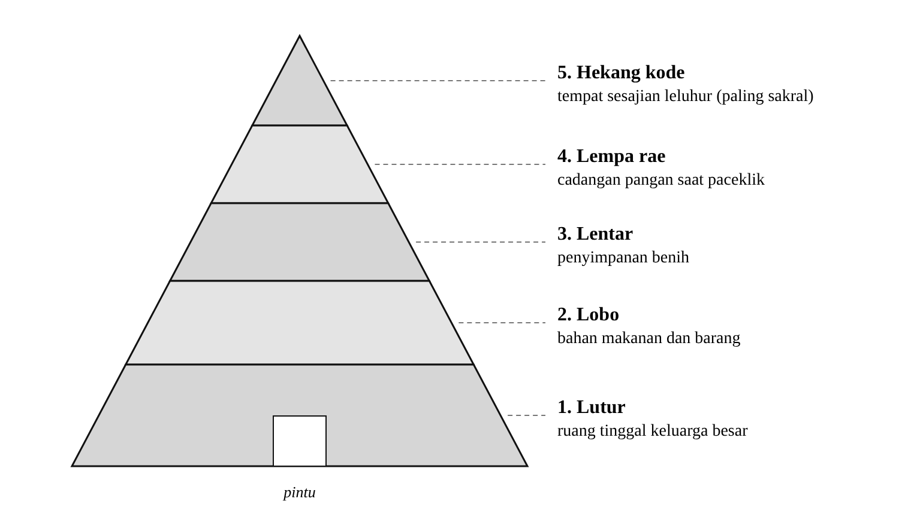{width=13cm}

### 2.4.2 Compang dan Penti

**Compang** adalah susunan batu berundak di tengah kampung, tempat meletakkan persembahan bagi penjaga dan pelindung kampung. **Penti** adalah pesta tahun baru adat Manggarai (Verheijen dalam Janggur, 2010) sekaligus syukur atas pergantian musim kerja dan hasil panen. Penti dirayakan antara September dan Desember dengan waktu yang bervariasi antarkampung. Di Kampung Pau, Penti meliputi ritus *Barong Lodok*, *Barong Wae Teku*, *Barong Boa*, dan *Barong Compang*, yaitu penghormatan di lingko, mata air, makam, dan compang. Penti memiliki dimensi vertikal (syukur kepada *Mori Kraeng* dan leluhur), horizontal (relasi dengan alam), dan sosial (kebersamaan warga).

### 2.4.3 Kain Songke

*Towe songke* adalah kain tenun Manggarai dengan **warna dasar hitam** dan motif berwarna di atasnya. Warna hitam dikaitkan dengan iklim pegunungan yang dingin. Motif-motifnya bermakna: *jok* sebagai identitas Manggarai; *wela kaweng* (bunga) sebagai relasi manusia dengan alam; *ranggong* (laba-laba) sebagai kejujuran dan kerja keras; *su'i* (garis) sebagai kehidupan yang tumbuh dan batas hukum adat; serta *mata manuk* (mata ayam) sebagai lambang Tuhan Yang Maha Melihat (kajian motif Pong Lengor, *Nirwasita*, 2022). Makna warna benang selain hitam tidak ditemukan dalam sumber terverifikasi.

### 2.4.4 Musik Gong-Gendang dan Nyanyian

Tiga bentuk vokal adat utama adalah *sanda* (berdiri melingkar, tanpa alat musik), *mbata* (duduk, diiringi gong dan gendang yang lembut), dan *danding* (berkelompok, bergerak melingkar). Pukulan gong-gendang mengiringi berbagai ritus, termasuk *congko lokap* (peresmian rumah adat), dan polanya telah ditranskripsi dalam kajian akademik (*Jurnal Citra Pendidikan*, 2022).

### 2.4.5 Caci

Caci adalah tari-tarung cambuk yang dimainkan berpasangan oleh pria Manggarai dan diwariskan turun-temurun. Caci lazim dipentaskan pada perayaan syukur panen dan Penti. Dua peran utamanya adalah **paki** (pencambuk) dan **ta'ang** (penangkis) (*Paradigma*, 2024). Paki menyerang dengan **larik**, cambuk dari kulit kerbau. Ta'ang bertahan dengan **nggiling**, perisai bundar dari kulit kerbau, dan **agang/tereng**, busur penangkis dari rotan atau bambu. Pemain mengenakan **panggal**, penutup kepala menyerupai tanduk kerbau, serta **ndeki**, hiasan menyerupai ekor di pinggang belakang. Serangan hanya sah ke tubuh di atas pinggang, dan pemain yang terkena di mata dinyatakan kalah.

Caci melambangkan kejantanan, kemeriahan, dan sportivitas, serta menegaskan nilai kebersamaan, persaudaraan, dan gotong royong (*Equilibrium*, 2019). Dengan kata lain, caci adalah ketangkasan yang dibingkai persaudaraan, bukan permusuhan. Status caci sebagai Warisan Budaya Takbenda Indonesia belum ditemukan konfirmasi resminya dalam riset ini [PERLU VERIFIKASI].

### 2.4.6 Lingko

*Lingko* adalah tanah ulayat komunal yang dibagi kepada keluarga-keluarga anggota kampung. Pola pembagian **lingko lodok** membentuk petak-petak menyerupai **jaring laba-laba**, dengan contoh terkenal di Cancar dan Meler dekat Ruteng (Mongabay Indonesia, 2017). Di titik pusat (*lodok*) ditanam kayu *teno*, lalu ditarik garis batas *moso* ke tepi lahan. Lingko melambangkan kekuatan kolektif masyarakat dalam mengolah tanah bersama. Pola juringnya juga telah dikaji sebagai sumber etnomatematika (*JPMI*, 2023).

## 2.5 Identifikasi Elemen yang Dapat Diadaptasi

Hasil studi literatur dianalisis untuk menemukan elemen yang dapat diadaptasi menjadi mekanik, visual, audio, dan narasi game. Ringkasannya ditunjukkan pada Tabel 2.2.

: Tabel 2.2 Identifikasi Elemen Budaya yang Dapat Diadaptasi

| Elemen budaya | Fakta kunci | Adaptasi ke game |
|------------------|------------------------------------|------------------------------------------|
| Pewarisan pengetahuan adat dari orang ke orang | Pengetahuan budaya diwariskan dalam komunitas | Mekanik **rantai teka-teki**: kartu pengetahuan dipegang 8 warga dan dikumpulkan berurutan |
| Songke | Dasar hitam, motif berulang yang teliti | Mekanik **menenun**: menyamakan kain 5×5 dengan contoh motif belah ketupat |
| Gong-gendang | Mengiringi upacara dan caci | Mekanik **tabuh**: menabuh mengikuti irama |
| Mbaru Niang | 7 rumah kerucut, 5 tingkat | Latar 3D, rumah dapat dimasuki, teka-teki tingkat rumah |
| Compang | Altar batu sakral di natas | *Landmark* yang hanya dilihat |
| Penti | Tahun baru adat dan syukur | Bingkai cerita dan ending perayaan |
| Caci | Paki dan ta'ang, nilai sportivitas | Pertunjukan pada ending, kartu, dan teka-teki |
| Bahasa | Sapaan hormat *ité*, *Kraeng*, *ema* | Dialog tokoh |

Kartu pengetahuan budaya berjumlah sembilan, yaitu Mbaru Niang, Kampung Wae Rebo, Compang, Kain Songke, Penti, Gong-Gendang dan Nyanyian, Caci (Paki dan Ta'ang), Perlengkapan Caci, dan Nilai Sportivitas Caci. Setiap kartu memuat fakta dari penelitian ini, sehingga game sekaligus berfungsi sebagai media edukasi. Isi lengkap kartu terdapat pada Lampiran D.

## 2.6 Pertimbangan Etis

Agar budaya ditampilkan dengan hormat, pengembangan game berpegang pada prinsip berikut:

1. **Ruang sakral tidak dijadikan objek permainan.** *Hekang kode*, compang, dan ritus *barong* hanya ditampilkan atau diceritakan, tidak dapat dipanjat atau "dimainkan". Tidak ada simulasi persembahan.
2. **Caci tidak digambarkan sebagai kekerasan.** Caci ditampilkan sebagai pertunjukan tanpa darah, dengan narasi yang menekankan sportivitas dan persaudaraan.
3. **Komunitas nyata dihormati.** Wae Rebo adalah kampung yang hidup. Tokoh dalam game bersifat fiktif dan kampungnya disebut *terinspirasi* Wae Rebo.
4. **Fakta dibedakan dari tafsir kreatif.** Pola motif 5×5, pola irama gong-gendang, dan perempuan pembawa kopi adalah tafsir kreatif pengembang [PERLU VERIFIKASI].
5. **Hak cipta dihormati.** Tidak ada rekaman musik adat atau foto pihak lain yang dipakai. Seluruh aset dibuat sendiri.
6. **Validasi komunitas.** Idealnya naskah dan istilah ditinjau penutur asli Manggarai sebelum rilis publik.

# BAB III ADAPTASI KONSEP

## 3.1 Game Design Document (GDD) Sederhana

Ringkasan rancangan game ditunjukkan pada Tabel 3.1.

: Tabel 3.1 Ringkasan Game Design Document

| Aspek | Keterangan |
|----------------|------------------------------------------------------------|
| Judul | Jejak Penti di Wae Rebo |
| Genre | Petualangan jelajah budaya 3D orang ketiga dengan rantai teka-teki dan mini-game |
| Platform | Web (browser laptop dan HP), Windows, macOS, Android |
| Target pemain | Remaja hingga dewasa (13+), pemain kasual, pelajar/mahasiswa |
| Durasi bermain | ±10–15 menit |
| Kamera | Orang ketiga, kamera tetap mengikuti pemain |
| Bahasa | Bahasa Indonesia dengan istilah Manggarai terverifikasi |
| Unsur budaya | Mbaru Niang dan Wae Rebo, compang, Penti, songke, gong-gendang dan nyanyian, caci |

**Premis cerita.** Nggohak, pemuda Manggarai yang disapa "Kraeng", pulang ke kampung adat bergaya Wae Rebo menjelang Penti. Menurut Tu'a Golo (tetua kampung), setiap warga menyimpan satu kartu pengetahuan budaya yang harus dikumpulkan secara berurutan. Setiap warga memberi tantangan, lalu menunjukkan siapa yang harus ditemui berikutnya lewat petunjuk berupa teka-teki. Setelah sembilan kartu terkumpul, Penti dimulai: warga menari dan dua pemuda menampilkan caci.

**Revisi konsep.** Konsep game mengalami tiga kali perubahan seperti pada Tabel 3.2. Konsep akhir dipilih karena lebih mudah dimainkan pemain umum dan mengenalkan lebih banyak unsur budaya, sementara caci tetap tampil dengan hormat.

: Tabel 3.2 Riwayat Revisi Konsep

| Versi | Konsep | Alasan perubahan |
|:-----:|----------------------------------|----------------------------------------|
| 0.x | Game 2D: teka-teki lingko dan duel caci | Rancangan awal |
| 1.x | Game 3D: jelajah kampung dan duel caci (paki/ta'ang, 3 lawan) | Lebih imersif |
| 2.0 | Game 3D jelajah budaya: rantai teka-teki, menenun songke, tabuh gong-gendang; caci sebagai pertunjukan Penti | Duel caci terlalu sulit bagi pemain umum; unsur budaya yang dikenalkan lebih banyak |

## 3.2 Core Loop dan Mekanik Gameplay

### 3.2.1 Core Loop

Core loop permainan ditunjukkan pada Gambar 3.1. Pemain menemui warga yang ditunjuk petunjuk, menyelesaikan tantangan, mendapatkan kartu budaya yang dibacakan, lalu menerima petunjuk menuju warga berikutnya. Karena jawaban teka-teki berasal dari isi kartu yang sudah dikumpulkan, loop ini sekaligus menjadi **loop belajar**.

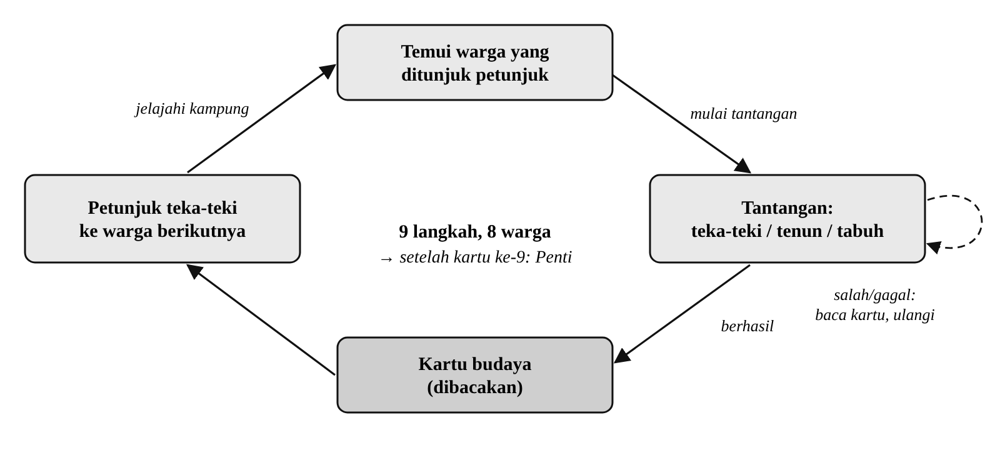{width=14cm}

### 3.2.2 Mekanik 1: Rantai Teka-teki dan Jelajah

Kartu dipegang delapan warga dan harus dikumpulkan berurutan. Petunjuk tidak menyebut nama atau lokasi secara langsung, melainkan ciri orang atau rumah, misalnya *"Di depan sebuah rumah, sehelai kain berdasar hitam dijemur menunggu kering. Pemilik kain itu tidak berada di luar."* Untuk menambah tantangan, tiga pemegang kartu menunggu di **dalam** Mbaru Niang yang tidak bersebelahan, dan tiga warga lain **berjalan atau bertukar tempat**. Teka-teki berbentuk pilihan ganda empat opsi dengan pengecoh yang mirip. Bila jawaban salah, warga menyarankan pemain membaca kembali koleksi kartu. Urutan lengkapnya ditunjukkan pada Tabel 3.3.

: Tabel 3.3 Urutan Rantai Teka-teki

| No | Warga (keberadaan) | Tantangan dan jawaban | Kartu yang diperoleh |
|:--:|-------------------------------|------------------------------------------|----------------------|
| 1 | Tu'a Golo (dekat compang) | Jumlah Mbaru Niang: **Tujuh** | Compang |
| 2 | Ine Wela (alat tenun, barat) | Mini-game menenun songke | Kain Songke |
| 3 | Ema Agus (di dalam mbaru gendang) | Motif hewan penenun jaring: **Ranggong** | Mbaru Niang |
| 4 | Ende Lono (di dalam rumah berjemuran songke) | Tingkat penyimpan benih: **Lentar** | Kampung Wae Rebo |
| 5 | Fransi (berkeliling dekat gong) | Mini-game tabuh gong-gendang | Gong, Gendang & Nyanyian |
| 6 | Hingha (bertukar tempat di arena) | Nyanyian sambil duduk: **Mbata** | Caci: Paki dan Ta'ang |
| 7 | Marngem (bertukar tempat dengan Hingha) | Sasaran sah pukulan: **di atas pinggang** | Perlengkapan Caci |
| 8 | Ema Yakobus (di dalam rumah berkayu bakar) | Hiasan ekor di pinggang: **Ndeki** | Nilai Sportivitas Caci |
| 9 | Tu'a Golo | Tahun penghargaan UNESCO: **2012** | Penti, lalu ending |

### 3.2.3 Mekanik 2: Menenun Songke

Pemain menyamakan kain 5×5 dengan contoh motif belah ketupat (dasar hitam, cincin kuning, cincin merah, dan pusat hijau). Pemain memilih kotak dengan tombol arah, klik, atau ketukan, lalu mengganti warna benang. Mini-game selesai otomatis ketika kain sama persis dengan contoh. Umpan balik berupa jumlah kotak yang belum sama, jumlah langkah, dan efek suara.

### 3.2.4 Mekanik 3: Tabuh Gong-Gendang

Pemain menabuh gong (tombol J) dan gendang (tombol K) saat ketukan yang bergerak dari kanan tiba di garis tabuh. Terdapat 15 ketukan pada tempo 76 BPM. Tabuhan dianggap tepat bila berada dalam rentang ±0,2 detik dari ketukan, dan pemain lulus bila minimal 60% ketukan tepat. Rancangan tampilan kedua mini-game ditunjukkan pada Gambar 3.2.

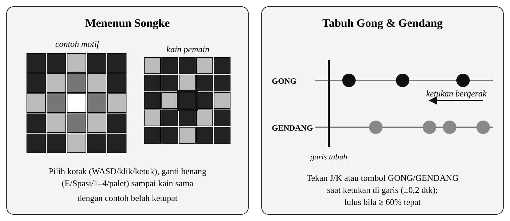{width=14cm}

## 3.3 Desain Level

Kampung disusun seperti Wae Rebo: tujuh Mbaru Niang melingkari compang di natas, dengan arena caci di sisi timur dan titik muncul pemain di selatan. Semua rumah dapat dimasuki. Saat pemain masuk, atap menghilang sehingga isi rumah (lantai kayu, tungku api, tikar) terlihat. Rumah pemegang kartu dikenali dari cirinya: paling besar (mbaru gendang), ada jemuran kain songke, atau ada tumpukan kayu bakar. Anjing dan ayam berkeliaran sebagai penghidup suasana. Denah kampung ditunjukkan pada Gambar 3.3.

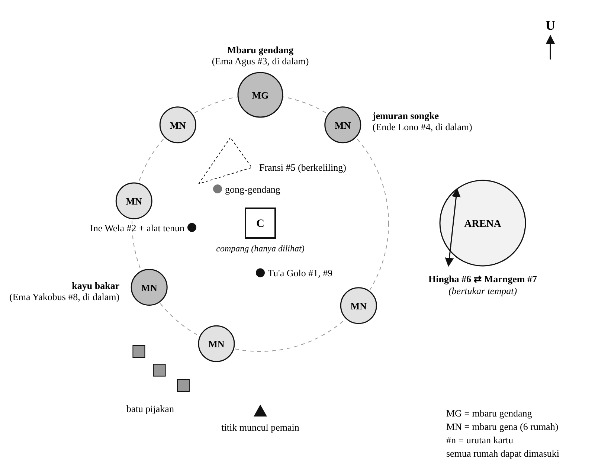{width=14cm}

## 3.4 Integrasi Unsur Budaya

### 3.4.1 Visual (Karakter, Environment, UI)

1. **Karakter** bergaya anime 3D: kepala dan mata besar, kulit cokelat, rambut bergelombang (pendek untuk laki-laki, panjang terurai untuk perempuan), dan sarung bermotif songke. Pemain caci mengenakan panggal dan membawa larik serta nggiling.
2. **Environment** berupa tujuh Mbaru Niang beratap ijuk, compang, gong dan gendang, arena caci, alat tenun, jemuran songke, kayu bakar, pepohonan, dan bukit.
3. **UI** memakai panel berbingkai motif songke dengan palet hitam, merah, kuning, dan hijau.

### 3.4.2 Audio (Musik dan Efek Suara)

Musik latar berupa pola gong-gendang yang tenang untuk kampung dan lebih cepat untuk perayaan. Efek suara meliputi gong, gendang, langkah, lompat, klik, berhasil, gagal, gonggongan anjing, dan kokok ayam. Seluruh audio disintesis sendiri sebagai penghormatan, bukan rekaman musik adat asli.

### 3.4.3 Narasi (Cerita dan Dialog)

Narasi dibingkai oleh persiapan Penti. Dialog **diucapkan** dengan *Text-to-Speech* bahasa Indonesia dengan nada suara berbeda untuk setiap tokoh, sedangkan teks hanya tampil sebagai cadangan. Tokoh menyapa pemain dengan *Kraeng* dan memakai sapaan hormat *ité*. Pesan utama yang disampaikan adalah sportivitas, persaudaraan, dan saling mengenalkan budaya. Ringkasan integrasi budaya ditunjukkan pada Tabel 3.4.

: Tabel 3.4 Integrasi Budaya per Aspek

| Aspek | Wujud dalam game |
|--------------|------------------------------------------------------------|
| Mekanik | Menenun motif songke, menabuh gong-gendang, teka-teki tentang Mbaru Niang, songke, nyanyian adat, dan caci |
| Visual | 7 Mbaru Niang melingkari compang, tokoh berkulit cokelat dan bersarung songke, panel UI bermotif songke |
| Audio | Pola gong-gendang, SFX interaktif, dialog bersuara |
| Narasi | Bingkai Penti, sapaan *ité* dan *Kraeng*, nilai sportivitas |
| Edukasi | 9 kartu budaya yang dibacakan dan dapat dibaca ulang di menu jeda |
| Kepekaan | Compang hanya dilihat; caci sebagai pertunjukan, bukan pertarungan |

## 3.5 Rancangan Kontrol

Game dapat dimainkan dengan keyboard, mouse, maupun layar sentuh seperti pada Tabel 3.5.

: Tabel 3.5 Rancangan Kontrol

| Aksi | Keyboard / mouse | Layar sentuh (HP) |
|-------------------|------------------------------|------------------------------|
| Bergerak | W A S D / tombol panah | Joystick virtual (kiri layar) |
| Melompat | Spasi | Tombol LOMPAT |
| Bicara / lanjut dialog | E / Enter / klik | Tombol BICARA / ketuk layar |
| Menjawab teka-teki | Klik, panah + Enter, atau 1–4 | Ketuk pilihan |
| Menenun | Panah, E/Spasi, 1–4, klik | Ketuk kotak dan palet |
| Menabuh | J (gong), K (gendang) | Tombol GONG / GENDANG |
| Jeda dan koleksi kartu | Esc / P | Tombol II |

## 3.6 Rancangan State Management

State management dirancang dalam tiga lapis. Lapis pertama adalah **GameState** yang mengatur keadaan global permainan, yaitu MENU, BERMAIN, DIALOG, JEDA, MINIGAME, dan SELESAI (Gambar 3.4). Transisi yang tidak terdaftar ditolak sehingga keadaan permainan selalu konsisten. Contohnya, menu jeda tidak dapat dibuka saat dialog atau saat menjawab teka-teki.

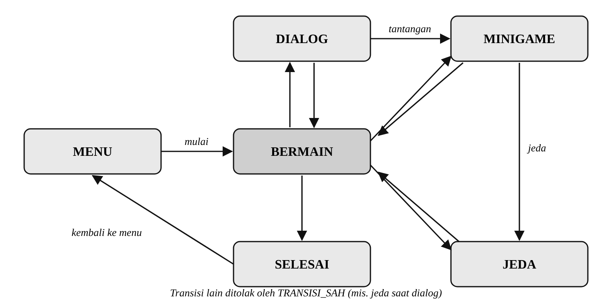{width=14cm}

Lapis kedua adalah **FSM pemain** dengan lima state, yaitu Idle, Jalan, Lompat, Jatuh, dan Interaksi (Gambar 3.5). Lapis ketiga adalah FSM untuk NPC: warga memiliki state DIAM dan JALAN untuk berpatroli, sedangkan penampil caci pada ending memiliki lima state, yaitu Siaga, Ancang, Serang, Tangkis, dan Terkena.

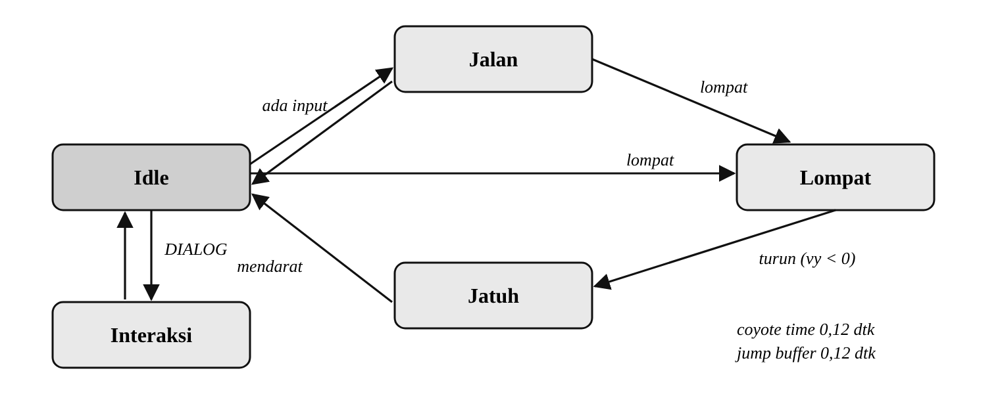{width=14cm}

# BAB IV IMPLEMENTASI TEKNIS

## 4.1 Setup Project Game Engine

Proyek dibangun dengan **Godot Engine 4** (diuji pada versi 4.7.2) menggunakan renderer *Compatibility* yang ringan dan mendukung ekspor ke web. Resolusi dasar 640×360 piksel diskalakan ke 1280×720. Lingkungan pengembangan ditunjukkan pada Tabel 4.1.

: Tabel 4.1 Lingkungan Pengembangan

| Komponen | Keterangan |
|---------------------|------------------------------------------------------------|
| Game engine | Godot Engine 4.7.2, renderer Compatibility (OpenGL ES 3 / WebGL 2) |
| Bahasa pemrograman | GDScript dengan *static typing* |
| Pembuatan aset | Python (Pillow untuk tekstur, NumPy untuk sintesis audio) |
| Pengelolaan kode | Git dan GitHub |
| Build otomatis | GitHub Actions dan GitHub Pages |
| Pengujian | Godot pada macOS dan browser Chromium (mode HP) |

Kode proyek terdiri atas 37 skrip GDScript (±3.500 baris), 5 scene, 3 berkas data JSON, 12 tekstur, dan 15 berkas audio. Arsitektur proyek ditunjukkan pada Gambar 4.1. Konten seperti urutan warga, pertanyaan, jawaban, petunjuk, dan isi kartu disimpan dalam JSON yang terpisah dari kode, sehingga dapat diubah tanpa mengubah program.

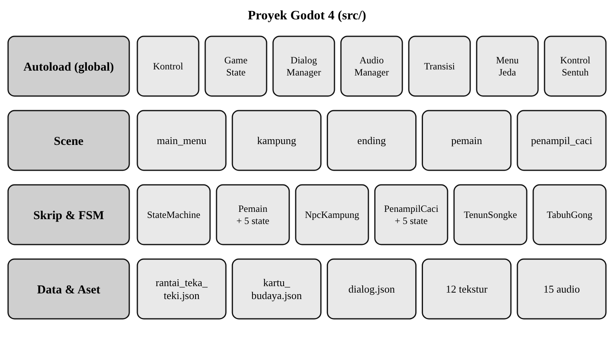{width=14cm}

## 4.2 Implementasi Kontrol Dasar: Input, Movement, dan Collision

**Input.** Seluruh pemetaan tombol didaftarkan lewat kode pada *autoload* `Kontrol`, sehingga tercatat di satu tempat. Aksi yang didaftarkan meliputi kiri, kanan, maju, mundur, lompat, interaksi, tabuh_gong, tabuh_gendang, dan jeda. Untuk HP, *autoload* `KontrolSentuh` menampilkan joystick virtual dan tombol sentuh yang hanya muncul pada perangkat layar sentuh.

**Movement.** Pemain adalah `CharacterBody3D` dengan akselerasi dan gesekan agar gerak terasa halus. Lompatan dibuat responsif dengan *coyote time* (pemain masih dapat melompat 0,12 detik setelah meninggalkan pijakan) dan *jump buffer* (tombol lompat yang ditekan sesaat sebelum mendarat tetap dihitung). Tinggi lompatan bervariasi sesuai lamanya tombol ditahan. Potongan kodenya ditunjukkan pada Kode 4.1.

::: {custom-style="Kode Judul"}
Kode 4.1 Coyote time dan jump buffer (pemain.gd)
:::

```
func _physics_process(delta: float) -> void:
    # Coyote time & jump buffer membuat lompatan terasa responsif
    if is_on_floor():
        _sisa_coyote = waktu_coyote
    else:
        _sisa_coyote = maxf(_sisa_coyote - delta, 0.0)
    if boleh_bergerak() and Input.is_action_just_pressed("lompat"):
        _sisa_buffer = waktu_buffer_lompat
    else:
        _sisa_buffer = maxf(_sisa_buffer - delta, 0.0)
    _perbarui_interaktif_terdekat()
```

**Collision.** Tanah, Mbaru Niang, compang, batu pijakan, pohon, dan batas dunia memiliki *collision shape*. Dinding Mbaru Niang dibuat dari 18 segmen yang melingkar dengan celah pada pintu, sehingga pemain hanya dapat masuk lewat pintu. Area interaksi (`Area3D`) mendeteksi warga atau objek terdekat dan menampilkan label "[E] Bicara".

## 4.3 Penerapan State Management untuk Karakter/NPC

**GameState.** Keadaan global disimpan pada *autoload* `GameState`. Setiap perubahan state diperiksa terhadap tabel transisi sah (`TRANSISI_SAH`) seperti pada Kode 4.2.

::: {custom-style="Kode Judul"}
Kode 4.2 Validasi transisi state global (game_state.gd)
:::

```
const TRANSISI_SAH: Dictionary = {
    State.MENU: [State.BERMAIN],
    State.BERMAIN: [State.DIALOG, State.JEDA, State.MINIGAME,
                    State.SELESAI, State.MENU],
    State.DIALOG: [State.BERMAIN, State.MINIGAME],
    State.JEDA: [State.BERMAIN, State.MINIGAME, State.MENU],
    State.MINIGAME: [State.BERMAIN, State.JEDA, State.DIALOG,
                     State.MENU],
    State.SELESAI: [State.MENU],
}

func ubah_state(baru: int) -> bool:
    if baru == state:
        return true
    var sah: Array = TRANSISI_SAH[state]
    if not sah.has(baru):
        push_warning("Transisi state ditolak")
        return false
    var lama: int = state
    state = baru
    state_berubah.emit(lama, baru)
    return true
```

**StateMachine generik.** Pemain dan penampil caci memakai *finite state machine* (FSM) berbasis node yang dapat dipakai ulang. Setiap state adalah node anak dengan fungsi `masuk`, `keluar`, `update`, dan `physics_update`. Inti pergantian state ditunjukkan pada Kode 4.3.

::: {custom-style="Kode Judul"}
Kode 4.3 Pergantian state pada StateMachine (state_machine.gd)
:::

```
func ganti(nama: String, data: Dictionary = {}) -> void:
    var kunci: String = nama.to_lower()
    if not _states.has(kunci):
        push_error("State tidak ditemukan: " + nama)
        return
    var dari: String = ""
    if state_aktif:
        dari = String(state_aktif.name)
        state_aktif.keluar()
    state_aktif = _states[kunci]
    state_aktif.masuk(data)
    state_berganti.emit(dari, String(state_aktif.name))
```

**NPC.** Warga kampung (`NpcKampung`) memiliki FSM sederhana DIAM dan JALAN untuk berpatroli di antara titik-titik tertentu. Mereka hanya bergerak saat GameState bernilai BERMAIN dan berhenti saat diajak bicara. Hewan (anjing dan ayam) juga memakai FSM DIAM/JALAN. Pada ending, dua penampil caci memakai FSM lima state (Siaga, Ancang, Serang, Tangkis, Terkena) dan bergantian berperan sebagai paki dan ta'ang.

## 4.4 Implementasi Mekanik Gameplay Utama

**Rantai teka-teki.** Saat pemain berbicara dengan warga, game memeriksa apakah warga tersebut pemegang tantangan yang sedang aktif. Jenis tantangan (teka-teki, tenun, atau gong) dibaca dari data JSON, lalu tantangan yang sesuai dijalankan. Bila berhasil, kartu dikumpulkan, rantai maju satu langkah, dan petunjuk ke warga berikutnya disampaikan (Kode 4.4).

::: {custom-style="Kode Judul"}
Kode 4.4 Alur tantangan pada rantai teka-teki (kampung.gd)
:::

```
func _mulai_tantangan(tantangan: Dictionary) -> void:
    match str(tantangan["jenis"]):
        "tenun":
            var tenun: TenunSongke = TENUN.new()
            tenun.selesai.connect(
                _hasil_minigame.bind(tantangan, "tenun_gagal"))
            add_child(tenun)
        "gong":
            var tabuh: TabuhGong = TABUH.new()
            tabuh.selesai.connect(
                _hasil_minigame.bind(tantangan, "gong_gagal"))
            add_child(tabuh)
        _:
            DialogManager.ajukan_teka_teki(tantangan["pemegang"],
                tantangan["pertanyaan"], tantangan["pilihan"],
                int(tantangan["benar"]),
                _hasil_teka_teki.bind(tantangan))

func _tantangan_berhasil(tantangan: Dictionary) -> void:
    GameState.kumpulkan_kartu(tantangan["kartu"])
    GameState.maju_rantai()
    DialogManager.tampilkan_kartu(tantangan["kartu"],
        _sampaikan_petunjuk.bind(tantangan))
```

Contoh satu langkah rantai dalam berkas `rantai_teka_teki.json` ditunjukkan pada Kode 4.5. Dengan format ini, pertanyaan, pilihan, jawaban, dan petunjuk dapat diubah tanpa menyentuh kode.

::: {custom-style="Kode Judul"}
Kode 4.5 Contoh data satu langkah rantai (rantai_teka_teki.json)
:::

```
{
  "pemegang": "Ema Agus",
  "kartu": "mbaru_niang",
  "jenis": "teka_teki",
  "pertanyaan": "Motif songke yang terinspirasi hewan penenun
      jaring, dan melambangkan kejujuran serta kerja keras,
      disebut apa?",
  "pilihan": ["Mata manuk", "Ranggong", "Belah ketupat", "Su'i"],
  "benar": 1,
  "petunjuk": "Di depan sebuah rumah, sehelai kain berdasar
      hitam dijemur menunggu kering. Pemilik kain itu tidak
      berada di luar."
}
```

**Mini-game menenun songke** (`TenunSongke`) menggambar dua grid 5×5, yaitu contoh motif dan kain pemain, beserta palet empat warna benang. Setiap perubahan warna dibandingkan dengan contoh; bila seluruh kotak sama, sinyal `selesai(true)` dikirim. **Mini-game tabuh gong-gendang** (`TabuhGong`) menyusun ketukan dari pola irama, menggerakkannya ke garis tabuh, lalu menilai ketepatan setiap tabuhan terhadap jendela ±0,2 detik. Musik latar dijeda selama mini-game berlangsung.

**Dialog bersuara.** *Autoload* `DialogManager` mengucapkan dialog memakai `DisplayServer.tts_speak` dengan suara bahasa Indonesia dan nada berbeda untuk setiap tokoh. Bila perangkat tidak memiliki suara bahasa Indonesia, dialog otomatis ditampilkan sebagai teks.

## 4.5 Integrasi Aset Visual dan Audio

Seluruh aset dibuat sendiri sehingga tidak ada masalah lisensi:

1. **Model 3D** dibangun dari *primitive mesh* Godot (kapsul, kotak, bola, silinder, torus) oleh skrip `KarakterModel`, `Dunia`, dan `Hewan`.
2. **Tekstur** berukuran 64×64 piksel dibuat dengan skrip Python `tools/generate_textures.py`: songke empat varian, ijuk, rumput, tanah, batu, kayu, kulit kerbau, dan bingkai UI bermotif songke.
3. **Audio** disintesis dengan skrip `tools/generate_audio.py` (sintesis aditif dengan NumPy): dua musik latar berpola gong-gendang dan 13 efek suara.
4. **Suara dialog** memakai mesin Text-to-Speech bawaan sistem operasi atau browser.

Daftar aset lengkap (asset references) terdapat pada Lampiran B.

## 4.6 Penerapan Prinsip Animasi Dasar

Karakter tidak memakai rig tulang. Sendi dibuat sebagai titik putar (*pivot*) dan dianimasikan secara prosedural dengan *Tween* dan fungsi sinus. Penerapan prinsip animasi dasar ditunjukkan pada Tabel 4.2.

: Tabel 4.2 Penerapan Prinsip Animasi

| Prinsip animasi | Penerapan dalam game |
|--------------------|------------------------------------------------------------|
| Anticipation | Penampil caci menarik larik ke belakang sebelum memukul |
| Timing | Ancang-ancang lambat, pukulan sangat cepat (0,09 detik) |
| Follow-through | Lengan dan larik melewati sasaran lalu kembali dengan *easing* elastis |
| Squash and stretch | Tubuh meregang saat melompat dan memampat saat mendarat; teks umpan balik "meletup" |
| Ease in / ease out | Transisi layar, gerak warga, perisai turun |
| Secondary action | Napas saat diam, ayunan lengan, penari Penti, ekor anjing bergoyang, ayam mematuk |

## 4.7 Build dan Publikasi

Proyek menyediakan preset ekspor untuk Windows (.exe), Web, macOS, dan Android (.apk). Versi web dibangun **otomatis** dengan GitHub Actions setiap kali kode berubah, lalu dipasang di GitHub Pages sehingga game dapat dimainkan langsung lewat browser laptop maupun HP (Gambar 4.2).

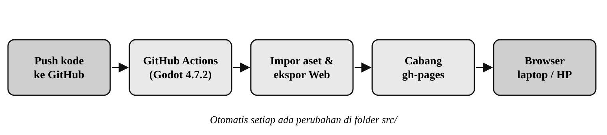{width=14cm}

## 4.8 Tampilan Program

Tampilan menu utama ditunjukkan pada Gambar 4.3. Menu utama menampilkan diorama kampung 3D dengan tombol Mulai Permainan, Cara Bermain, dan Tentang Game.

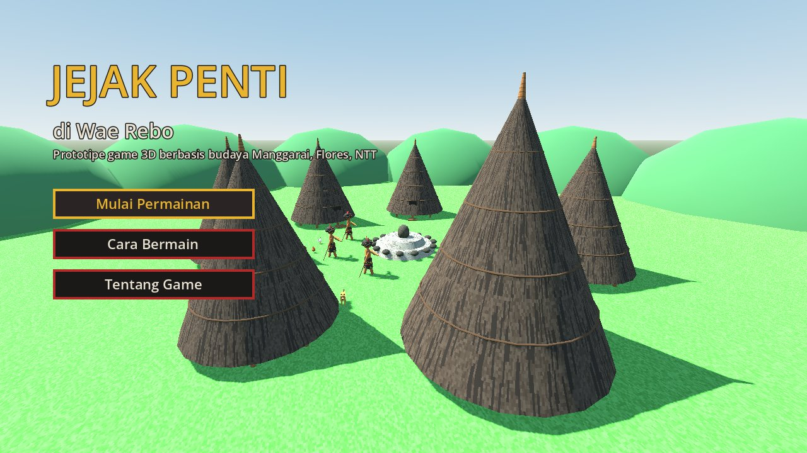{width=13.5cm}

Saat permainan dimulai, pemain muncul di sisi selatan kampung. HUD di kiri atas menampilkan petunjuk aktif dan jumlah kartu budaya yang sudah dikumpulkan (Gambar 4.4).

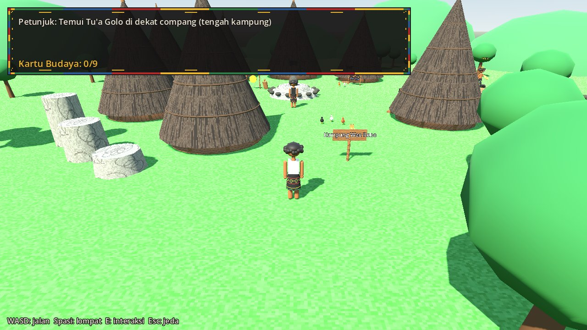{width=13.5cm}

Pada perangkat layar sentuh, joystick virtual dan tombol BICARA, LOMPAT, serta jeda muncul secara otomatis (Gambar 4.5).

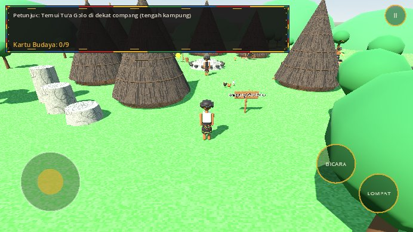{width=13.5cm}

# BAB V TESTING DAN POLISH

## 5.1 Pengujian Fungsional

Pengujian dilakukan dalam dua bentuk. Pertama, **validasi statis**: seluruh skrip lolos pemeriksaan parser GDScript (gdtoolkit), serta path resource, nama state, nama warga, dan kecocokan jawaban teka-teki dengan isi kartu diperiksa otomatis dengan skrip. Kedua, **uji fungsional** dengan menjalankan game di Godot 4.7.2 (macOS) dan di browser Chromium mode HP. Hasilnya ditunjukkan pada Tabel 5.1.

: Tabel 5.1 Hasil Pengujian Fungsional

| No | Skenario uji | Hasil yang diharapkan | Hasil |
|:--:|-----------------------------|------------------------------------------|:------:|
| 1 | Menjalankan game dari menu utama | Menu tampil, permainan dapat dimulai | Berhasil |
| 2 | Bergerak dan melompat | Pemain bergerak 4 arah dan melompat | Berhasil |
| 3 | Menabrak rumah, pohon, compang | Pemain tertahan, tidak tembus | Berhasil |
| 4 | Berbicara dengan Tu'a Golo | Dialog dan teka-teki pertama muncul | Berhasil |
| 5 | Validasi rantai dan data | 9 langkah, jawaban ada pada isi kartu | Berhasil |
| 6 | Versi web di browser HP | Menu tampil, dapat dimulai dengan ketukan, kontrol sentuh muncul, tanpa error | Berhasil |
| 7 | Build otomatis GitHub Actions | Versi web terbangun dan terpasang | Berhasil |

## 5.2 Playtesting dengan User

Playtest dilakukan oleh **3 penguji**, masing-masing bermain sekitar 8–10 menit. Pengamat tidak membantu kecuali penguji benar-benar macet, dan penguji diminta menceritakan apa yang dipikirkan selama bermain. Setelah bermain, penguji mengisi kuesioner tujuh pertanyaan berskala 1–5 tentang kemudahan kontrol, kejelasan tujuan, keseruan rantai teka-teki dan mini-game, kejelasan petunjuk dan dialog, serta kesesuaian tampilan dan musik dengan tema budaya. Kuesioner lengkap terdapat pada Lampiran C. Hasil playtest dirangkum pada Tabel 5.2.

: Tabel 5.2 Ringkasan Hasil Playtest

| Aspek | Hasil |
|-------------------------|------------------------------------------------------------|
| Jumlah penguji | 3 orang |
| Rata-rata skor kuesioner | **4 dari 5** |
| Temuan utama | Tampilan di HP masih kecil dan tombol sentuh masih kurang |

Skor rata-rata 4 dari 5 menunjukkan bahwa game secara umum diterima dengan baik oleh penguji. Temuan utama berkaitan dengan pengalaman bermain di HP, sehingga menjadi prioritas perbaikan berikutnya.

## 5.3 Iterasi Berdasarkan Feedback

Selama pengembangan, game diuji berulang kali dan diperbaiki berdasarkan masukan. Iterasi yang telah dilakukan ditunjukkan pada Tabel 5.3.

: Tabel 5.3 Iterasi Berdasarkan Feedback

| No | Sebelum | Sesudah | Alasan |
|:--:|----------------------------|------------------------------------|------------------------|
| 1 | Kabut tebal menutupi kampung | Kabut dihapus, kampung terlihat jelas | Warna dan bentuk kampung tertutup |
| 2 | Sapaan tokoh pemain "Nara" | Diganti "Kraeng" | Masukan pengembang |
| 3 | Kartu budaya tergeletak di atas batu | Kartu dipegang warga dan didapat berurutan | Lebih bermakna secara budaya |
| 4 | Duel caci sebagai inti permainan | Jelajah budaya, caci menjadi pertunjukan | Duel terlalu sulit bagi pemain umum |
| 5 | Dialog berupa teks | Dialog diucapkan (TTS), teks sebagai cadangan | Lebih imersif |
| 6 | Petunjuk langsung menyebut nama | Petunjuk berupa teka-teki ciri orang atau rumah | Agar pemain berpikir |
| 7 | Semua warga berdiri di luar | 3 warga di dalam rumah, 3 warga berpindah tempat | Menambah tantangan |
| 8 | Hanya dapat dimainkan di laptop | Kontrol sentuh dan versi web untuk HP | Menjangkau lebih banyak pemain |

Temuan playtest tentang tampilan HP yang masih kecil dan tombol yang masih kurang menjadi rencana iterasi berikutnya, yaitu memperbesar tampilan dan teks pada layar HP serta memperbesar atau menambah tombol sentuh.

## 5.4 Penyempurnaan Aspek Visual dan Gameplay

Selain iterasi di atas, penyempurnaan visual dan gameplay yang dilakukan meliputi:

1. Tokoh diubah menjadi gaya anime 3D yang lebih besar, berkulit cokelat, dan berambut bergelombang.
2. Anjing dan ayam ditambahkan sebagai penghidup suasana kampung, lengkap dengan animasi dan suara.
3. Ketujuh Mbaru Niang dapat dimasuki, lengkap dengan tungku api dan tikar, serta atap yang menghilang saat pemain di dalam.
4. Teka-teki dibuat empat pilihan dengan pengecoh yang mirip.
5. Palet benang pada mini-game tenun diperbesar dan dipindah agar mudah diketuk, serta ditambah tombol Berhenti.

# BAB VI DOKUMENTASI

## 6.1 Laporan Proses Development

Proses pengembangan dicatat dalam log pengembangan. Ringkasan kronologinya ditunjukkan pada Tabel 6.1.

: Tabel 6.1 Ringkasan Proses Development

| No | Kegiatan | Kendala | Solusi |
|:--:|------------------------------|------------------------------|------------------------------|
| 1 | Riset budaya: catatan, glosarium, tabel adaptasi, laporan | Banyak jurnal tidak dapat dibuka penuh | Fakta diambil dari abstrak; data belum pasti ditandai |
| 2 | Pembuatan aset: 12 tekstur dan 15 audio | Tidak ada aset 3D berlisensi bebas bernuansa Manggarai | Semua aset dibuat dengan skrip Python |
| 3 | Fondasi teknis: input, GameState, FSM, pemain 3D | — | — |
| 4 | Karakter prosedural dan animasi | Tidak memakai rig tulang | Sendi berupa pivot dianimasikan dengan Tween dan sinus |
| 5 | Kampung 3D dan interaksi | Batu pijakan bertabrakan dengan rumah | Jarak antarobjek dicek dengan skrip lalu posisi digeser |
| 6 | Revisi konsep menjadi jelajah budaya | Duel caci terlalu sulit | Rantai teka-teki dan dua mini-game |
| 7 | Rumah dapat dimasuki, warga bergerak | Kamera dan atap menghalangi | Atap disembunyikan saat pemain di dalam rumah |
| 8 | Kontrol sentuh dan versi web otomatis | Browser memuat suara TTS terlambat | Suara dicari ulang setiap dialog dimulai |
| 9 | Playtest 3 penguji | — | Hasil dicatat untuk iterasi |

## 6.2 Video Demo Gameplay

Video demo berdurasi 1–2 menit direkam dengan perekam layar (misalnya Cmd + Shift + 5 di macOS) pada resolusi 1080p, dengan suara sistem ikut terekam karena dialog game diucapkan. Naskah video ditunjukkan pada Tabel 6.2.

: Tabel 6.2 Naskah Video Demo

| Waktu | Visual | Narasi |
|:--------:|------------------------------------|------------------------------------|
| 0:00–0:08 | Menu utama, kamera mengorbit kampung | Pengenalan game jelajah budaya Manggarai |
| 0:08–0:20 | Nggohak berjalan dan melompat di kampung | Tujuh Mbaru Niang melingkari compang |
| 0:20–0:38 | Dialog Tu'a Golo, teka-teki, kartu dibacakan, masuk mbaru gendang | Rantai teka-teki dan petunjuk |
| 0:38–0:55 | Mini-game menenun songke | Mekanik menenun |
| 0:55–1:12 | Mini-game tabuh gong-gendang | Mekanik ritme |
| 1:12–1:25 | Teka-teki di arena, membuka koleksi kartu | Jawaban ada di kartu budaya |
| 1:25–1:55 | Ending Penti: penari dan pertunjukan caci | Pesan sportivitas dan persaudaraan |

## 6.3 Presentasi Hasil

Presentasi hasil disusun dalam 10 slide dengan susunan: (1) judul dan identitas; (2) latar budaya Manggarai; (3) metode riset; (4) revisi konsep; (5) core loop dan rantai teka-teki; (6) mini-game menenun dan menabuh; (7) integrasi budaya; (8) arsitektur teknis; (9) uji coba dan iterasi; serta (10) kesimpulan dan tautan game. Presentasi ditutup dengan penayangan video demo.

## 6.4 Kesesuaian dengan Kriteria Penilaian

Pemetaan hasil proyek terhadap kriteria penilaian tugas ditunjukkan pada Tabel 6.3.

: Tabel 6.3 Kesesuaian Hasil dengan Kriteria Penilaian

| Kriteria (bobot) | Indikator | Bukti dalam proyek |
|---------------------|------------------------------|------------------------------------------|
| Implementasi Teknis (40%) | Fitur teknis, kualitas kode, state management, stabilitas | Subbab 4.2–4.4; FSM tiga lapis; data terpisah dari kode; uji fungsional berhasil |
| Integrasi Budaya (30%) | Kedalaman riset, kreativitas adaptasi, konsistensi | BAB II (36 sumber, ±70 istilah); rantai teka-teki dan mini-game; budaya di semua aspek |
| Aset dan Visual (15%) | Keserasian visual, prinsip animasi, audio | Subbab 4.5–4.6; visual bertema Manggarai; 6 prinsip animasi; audio gong-gendang |
| Dokumentasi dan Presentasi (15%) | Kelengkapan dokumen, video demo, presentasi | Laporan ini, video demo, dan 10 slide presentasi |

# BAB VII PENUTUP

## 7.1 Kesimpulan

Berdasarkan seluruh tahapan yang telah dilaksanakan, dapat disimpulkan bahwa:

1. Budaya Manggarai berhasil diadaptasi menjadi game 3D jelajah budaya *Jejak Penti di Wae Rebo*. Mbaru Niang, compang, Penti, songke, gong-gendang, dan caci hadir dalam mekanik, visual, audio, dan narasi, didukung studi literatur terhadap 36 sumber.
2. Kontrol dasar (input, gerak, lompat, *collision*) dan *state management* tiga lapis (GameState, FSM pemain, FSM NPC dan penampil caci) telah diimplementasikan dengan Godot Engine 4.
3. Game memiliki tiga mekanik utama, yaitu rantai teka-teki, menenun songke, dan tabuh gong-gendang, sehingga memenuhi syarat minimal dua mekanik. Pengetahuan budaya menjadi kunci kemajuan permainan, bukan sekadar hiasan.
4. Aset visual dan audio dibuat sendiri dan menerapkan prinsip animasi dasar seperti anticipation, follow-through, serta squash and stretch.
5. Game dapat dimainkan dari awal sampai akhir di laptop dan HP melalui browser. Playtest dengan 3 penguji menghasilkan rata-rata skor 4 dari 5.

## 7.2 Saran

Untuk pengembangan selanjutnya, penulis menyarankan:

1. Memperbesar tampilan dan teks pada layar HP serta memperbesar atau menambah tombol sentuh, sesuai temuan playtest.
2. Menambahkan mekanik teka-teki lingko lodok (sawah jaring laba-laba) sebagai area baru.
3. Menambahkan fitur simpan permainan, kamera yang dapat diputar, dan dukungan *gamepad*.
4. Menggunakan rekaman gong-gendang asli dengan izin komunitas serta motif songke yang lebih beragam.
5. Memverifikasi isi kartu, istilah, dan dialog bersama budayawan atau penutur asli Manggarai.

# DAFTAR PUSTAKA

::: {custom-style="Pustaka"}
Antara Kupang. (2024). *Dirut BPOLBF: Budaya Manggarai jadi basis nilai pengembangan Parapuar*. https://kupang.antaranews.com

CREM-CNRS. (t.t.). *(Manggarai Timur) chœur mixte Mbata* [rekaman arsip]. https://archives.crem-cnrs.fr

Godot Engine. (2024). *Godot Engine documentation (4.x)*. https://docs.godotengine.org

Good News From Indonesia. (2015, 30 September). *Rumah tradisional Flores ini mendapat Award of Excellence dari UNESCO*. https://www.goodnewsfromindonesia.id

Good News From Indonesia. (2024, 12 Februari). *Potret kehidupan kolektif masyarakat Manggarai dalam budaya lonto leok*. https://www.goodnewsfromindonesia.id

Good News From Indonesia. (2024, 27 Maret). *Tenun songke, kearifan lokal khas Manggarai Flores Nusa Tenggara Timur*. https://www.goodnewsfromindonesia.id

Kementerian Pariwisata dan Ekonomi Kreatif RI. (t.t.). *Flores – Wae Rebo Village*. Indonesia.travel. https://www.indonesia.travel

Kementerian Pariwisata dan Ekonomi Kreatif RI. (t.t.). *The sacred rituals of Penti*. Indonesia.travel. https://indonesia.travel

Kementerian Pariwisata RI. (t.t.). *Atraksi Tarian Caci*. Jadesta. https://jadesta.kemenpar.go.id

Menggo, S. (2024). The function of honorific term ité: Cultural perspectives from Manggarai, Indonesia. *Journal of Language and Literature*.

Mongabay Indonesia. (2017, 28 Juli). *Sawah berbentuk jaring laba-laba di Manggarai ini, hanya satu-satunya di dunia*. https://mongabay.co.id

Moses, F. (2018). *Mengenal Manggarai di Nusa Tenggara Timur*. Badan Pengembangan dan Pembinaan Bahasa.

Nystrom, R. (2014). *Game programming patterns*. Genever Benning. https://gameprogrammingpatterns.com

Schell, J. (2019). *The art of game design: A book of lenses* (3rd ed.). CRC Press.

The Best in Heritage. (2013). *Mbaru Niang*. https://presentations.thebestinheritage.com

The Jakarta Post. (2016, 5 Mei). *Clean-up ritual à la Manggarai people*. https://www.thejakartapost.com

Thomas, F., & Johnston, O. (1981). *The illusion of life: Disney animation*. Abbeville Press.

Tourism Cambodia. (2012). *UNESCO Award of Excellence 2012 for Wae Rebo's Mbaru Niang traditional houses on Flores*. https://www.tourismcambodia.com

Udus, G. I., Wulakada, H. H., & Rahmawati, A. ([tahun PERLU VERIFIKASI]). [Sawah lodok di Meler, Ruteng]. *Jurnal Geografi*, Universitas Nusa Cendana.

[Penulis PERLU VERIFIKASI]. (2019). Nilai kesenian budaya tarian caci pada masyarakat Manggarai Kabupaten Manggarai Timur. *Equilibrium*.

[Penulis PERLU VERIFIKASI]. (2021). [Pertunjukan musik Mbata di Kota Komba]. *Jurnal Citra Pendidikan*, 1(2), 204–215.

[Penulis PERLU VERIFIKASI]. (2022). [Teknik pukulan gong dan gendang ritual congko lokap]. *Jurnal Citra Pendidikan*, 2(1), 84–92.

[Penulis PERLU VERIFIKASI]. (2022). [Motif tenun songke Pong Lengor]. *Nirwasita*, 3(1).

[Penulis PERLU VERIFIKASI]. (2022). Personal pronouns ité as politeness marker in Manggarai language and culture, Indonesia. *Edulite*.

[Penulis PERLU VERIFIKASI]. (2023). [Makna tarian caci]. *Jurnal Edukasi Citra Olahraga*.

[Penulis PERLU VERIFIKASI]. (2023). [Konsep matematis sawah lodok]. *JPMI*.

[Penulis PERLU VERIFIKASI]. (2024). [Paki dan ta'ang dalam caci]. *Paradigma: Jurnal Kajian Budaya*, 14(2). https://doi.org/10.17510/paradigma.v14i2.1387

[Penulis PERLU VERIFIKASI]. (2024). Tari tradisional caci perantau Manggarai di Pontianak. *BALELE*.

[Penulis PERLU VERIFIKASI]. (2025). Estetika ruang rumah adat Mbaru Niang Wae Rebo. *Jurnal Vastukara*, 5(1). https://doi.org/10.59997/vastukara.v5i1.4616

[Penulis PERLU VERIFIKASI]. (2025). Upaya pelestarian tari caci sebagai budaya lokal Kecamatan Manggarai, NTT. *Pilar*.

[Penulis & tahun PERLU VERIFIKASI]. [Prosedur pembagian tanah lingko dan rasa keadilan]. *Jurnal Alternatif*, Universitas Nusa Cendana.

[Penulis & tahun PERLU VERIFIKASI]. Pemanfaatan jenis-jenis tumbuhan bahan bangunan rumah adat Mbaru Niang Kampung Wae Rebo. *Biotropikal Sains*, Universitas Nusa Cendana.

[Penulis & tahun PERLU VERIFIKASI]. [Nilai dalam permainan caci]. *Verbavitae*, Universitas Katolik Widya Mandira.

[Penulis PERLU VERIFIKASI]. (t.t.). [Skripsi upacara Penti, mengutip Janggur (2010) dan Verheijen]. Repositori Universitas PGRI Adi Buana Surabaya.

[Penulis & tahun PERLU VERIFIKASI]. [Compang]. *Sosioreligius*, UIN Alauddin Makassar.
:::

# LAMPIRAN

## Lampiran A. Tautan Game dan Source Code

: Tabel A.1 Tautan Proyek

| Keterangan | Tautan |
|------------------|------------------------------------------------------------|
| Game (browser laptop/HP) | https://romanussudimin-debu.github.io/Pengembangan-Permainan-Digital/ |
| Source code | https://github.com/romanussudimin-debu/Pengembangan-Permainan-Digital |

## Lampiran B. Asset References

Seluruh aset dalam prototipe dibuat sendiri secara prosedural. Tidak ada aset pihak ketiga.

: Tabel B.1 Daftar Aset

| Aset | Jenis | Dibuat dengan | Lisensi |
|------------------------|------------------------------|------------------------------|-------------|
| Karakter (Nggohak, warga, penampil caci, penari) | Model 3D bergaya anime dan animasi prosedural | Godot (*primitive mesh*), `karakter_model.gd` | Milik pembuat |
| Mbaru Niang, compang, gong-gendang, pohon, bukit, arena | Model 3D low-poly | Godot (*primitive mesh*), `dunia.gd` | Milik pembuat |
| Anjing dan ayam | Model 3D dan animasi prosedural | Godot, `hewan.gd` | Milik pembuat |
| Tekstur songke (4 varian), ijuk, rumput, tanah, batu, kayu, kulit kerbau | Tekstur 64×64 piksel | Python Pillow, `generate_textures.py` | Milik pembuat |
| Bingkai UI songke | Tekstur 9-patch 48×48 piksel | Python Pillow | Milik pembuat |
| Musik kampung dan musik perayaan | Audio WAV, pola gong-gendang | Python NumPy, `generate_audio.py` | Milik pembuat |
| 13 efek suara (gong, gendang, langkah, lompat, klik, anjing, ayam, dll.) | Audio WAV | Python NumPy | Milik pembuat |
| Suara dialog | Text-to-Speech sistem operasi/browser | API Godot `tts_speak` | Bawaan sistem |
| Font | Font bawaan Godot | — | Bawaan Godot |

## Lampiran C. Kuesioner Playtest

: Tabel C.1 Pertanyaan Kuesioner Playtest

| No | Pertanyaan |
|:--:|------------------------------------------------------------------------|
| 1 | Seberapa mudah mengendalikan Nggohak? (1 = sulit, 5 = mudah) |
| 2 | Apakah tujuan permainan jelas? (1–5) |
| 3 | Seberapa seru rantai teka-teki (mencari warga dari petunjuk)? (1–5) |
| 4 | Seberapa seru mini-game menenun songke dan tabuh gong-gendang? (1–5) |
| 5 | Apakah petunjuk, teka-teki, dan dialog bersuara cukup jelas? (1–5) |
| 6 | Sebutkan 3 hal tentang budaya Manggarai yang Anda pelajari |
| 7 | Apakah tampilan dan musik terasa sesuai tema budaya? (1–5) |
| 8 | Bagian mana yang paling membingungkan atau mengganggu? |
| 9 | Satu saran perbaikan |

## Lampiran D. Isi Kartu Pengetahuan Budaya

: Tabel D.1 Isi Kartu Pengetahuan Budaya

| No | Kartu | Isi |
|:--:|------------------|------------------------------------------------------------|
| 1 | Mbaru Niang | Rumah adat berbentuk kerucut di Wae Rebo, beratap ijuk yang menjuntai hampir sampai tanah, terdiri atas 5 tingkat: lutur, lobo, lentar, lempa rae, dan hekang kode. |
| 2 | Kampung Wae Rebo | 7 Mbaru Niang melingkari halaman tengah: 1 mbaru gendang dan 6 mbaru gena. Pelestariannya meraih UNESCO Asia-Pacific Award (Award of Excellence) tahun 2012. |
| 3 | Compang | Altar batu berundak di natas, tempat persembahan kepada Mori Kraeng dan empo. Karena sakral, di dalam game hanya ditampilkan dan dijelaskan. |
| 4 | Kain Songke | Tenun berwarna dasar hitam dengan motif bermakna, misalnya ranggong (kejujuran dan kerja keras) dan mata manuk (Tuhan Yang Maha Melihat). |
| 5 | Penti | Perayaan tahun baru adat dan syukur atas pergantian musim kerja dan panen, biasanya September–Desember. |
| 6 | Gong, Gendang & Nyanyian | Gong dan gendang mengiringi upacara dan caci. Nyanyian: sanda (berdiri), mbata (duduk, diiringi gong-gendang), dan danding (bergerak melingkar). |
| 7 | Caci: Paki dan Ta'ang | Tari-tarung dua pria; paki mencambuk dan ta'ang menangkis secara bergantian. Pukulan hanya sah di atas pinggang. |
| 8 | Perlengkapan Caci | Larik (cambuk kulit kerbau), nggiling (perisai), agang/tereng (busur penangkis), panggal (penutup kepala), dan ndeki (hiasan ekor). |
| 9 | Nilai Sportivitas Caci | Caci bukan untuk saling melukai, melainkan ungkapan sportivitas, keberanian, dan persaudaraan. |

## Lampiran E. Glosarium Singkat

: Tabel E.1 Glosarium Istilah Manggarai

| Istilah | Arti |
|----------------|------------------------------------------------------------|
| Mbaru niang | Rumah adat kerucut Wae Rebo |
| Mbaru gendang | Rumah utama kampung, penyimpan pusaka |
| Mbaru gena | Rumah pendamping (6 di Wae Rebo) |
| Lutur, lobo, lentar, lempa rae, hekang kode | Tingkat 1–5 Mbaru Niang |
| Natas | Halaman tengah kampung |
| Compang | Altar batu berundak di tengah kampung |
| Penti | Tahun baru adat dan syukur panen |
| Songke | Kain tenun Manggarai berdasar hitam |
| Ranggong | Motif laba-laba (kejujuran, kerja keras) |
| Sanda, mbata, danding | Bentuk nyanyian adat |
| Caci | Tari-tarung cambuk |
| Paki / ta'ang | Pemain pencambuk / penangkis |
| Larik / nggiling | Cambuk / perisai kulit kerbau |
| Panggal / ndeki | Penutup kepala / hiasan ekor pemain caci |
| Lingko | Tanah ulayat komunal |
| Tu'a golo | Tua kampung |
| Ité | Kata ganti hormat "Anda" |
| Kraeng | Dipakai di game sebagai sapaan hormat untuk tokoh pemain [PERLU VERIFIKASI] |
| Mori Kraeng / empo | Tuhan / leluhur |
